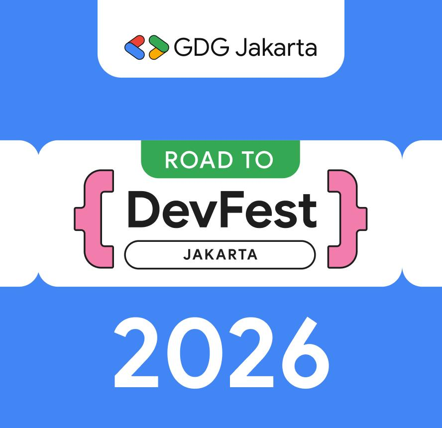
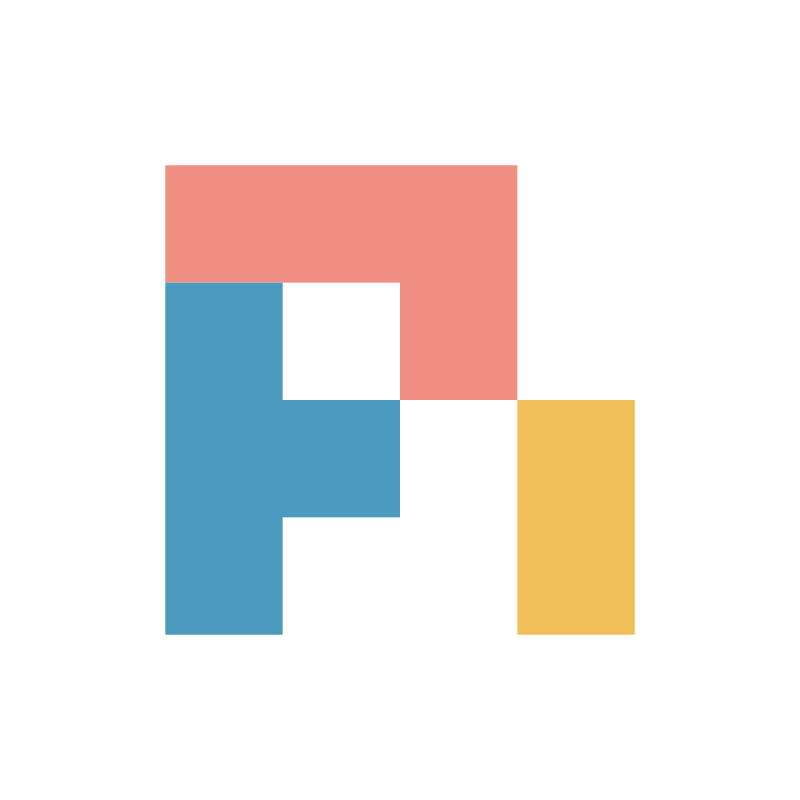

#

{width=300 style="margin: 20px auto; display: block;"}

## About Me {.smaller}

:::: {.columns}
::: {.column width="30%"}

{width=200 style="border-radius: 50%; margin-bottom: 15px; display: block; margin-left: auto; margin-right: auto;"}

<div style="font-size: 0.9em; line-height: 1.8;">

**x.com**/algonacci

**github.com**/algonacci

**linkedin.com**/eric-julianto

**instagram.com**/eric.juliantooo

</div>
:::

::: {.column width="70%"}
<div style="padding-left: 30px;">

**Work Experience**

<style>
.compact-list li { margin-bottom: 0.3em; line-height: 1.2; }
.compact-list .period { font-size: 0.85em; color: #666; display: block; margin-top: -0.2em; }
</style>

<div class="compact-list">

- Founder at Orvix.id
<span class="period">(Now)</span>

- Research Analyst at Braincore
<span class="period">(Dec 21 - Now)</span>

- Machine Learning Mentor at Bangkit Academy
<span class="period">(Feb 23 - Jan 24)</span>

- SEO Intern at Dibilabs by Dibimbing.id
<span class="period">(Mar 23 - Jun 23)</span>

- AI Developer Intern at ZettaByte
<span class="period">(May 22 - Aug 22)</span>

</div>

**Education**

- Hospitality & Tourism at Universitas Bunda Mulia
- Computer Science at Universitas Esa Unggul

</div>
:::
::::

#

{width=300 style="margin: 20px auto; display: block;"}

# Sprint Enablement {#enablement background-color="#2c3e50"}
Token Cloud Credits dari Orvix

## Yang Anda Dapat {#jatah .smaller}

:::: {.columns}
::: {.column width="62%"}

| | |
|:---|:---|
| **Kuota** | 100 juta token per orang<br>[≈ 8.000+ giliran agent dengan model default]{style="font-size: 0.8em; color: #666;"} |
| **Batas harian** | 30 juta token per hari<br>[rem darurat, bukan target]{style="font-size: 0.8em; color: #666;"} |
| **Berlaku** | sampai **1 November 2026, 23:59 WIB** |
| **Kecepatan** | 20 request/menit, 3 request bersamaan |
| **Endpoint** | `/v1` untuk aplikasi, `/coding/v1` untuk coding agent |
| **Model default** | DeepSeek V4.1 Flash<br>[+ 7 model lain, lihat slide berikutnya]{style="font-size: 0.8em; color: #666;"} |

:::
::: {.column width="38%"}

{width=260 fig-align="center"}

::: {.callout-note}
### Gratis, tanpa kartu
Kuota ini disponsori Orvix untuk sprint. Tidak perlu top-up untuk memakainya.
:::

:::
::::

## Model yang Tersedia {#model}

Satu API key, ganti model cukup ubah parameter `model`. Dikelompokkan dari yang paling hemat kuota:

:::: {.columns}
::: {.column width="33%"}
### Hemat

- {.model-logo} Muse Spark 1.3
- {.model-logo} Qwen 3.8 Flash
- {.model-logo} GPT-5.6 Luna
:::
::: {.column width="33%"}
### Menengah

- {.model-logo} **DeepSeek V4.1 Flash** (default)
- {.model-logo} Hy3
- {.model-logo} Gemini 3.8 Flash
:::
::: {.column width="33%"}
### Premium

- {.model-logo} GPT-5.6 Terra
- {.model-logo} GPT-5.6 Sol
:::
::::

::: {.callout-tip}
### Pilih sesuai tugas
Mulai dari model hemat atau default. Naik ke premium hanya untuk tugas yang memang butuh.
:::

## Klaim dalam 3 Langkah {#klaim}

:::: {.columns}
::: {.column width="40%"}

{width=300 fig-align="center"}

<div class="claim-url">
<span class="claim-host">platform.orvix.id/e/</span>
<span class="claim-code">ROAD-TO-DEVFEST-JKT-2026</span>
</div>

:::
::: {.column width="60%"}

1. **Scan QR** → masuk dengan email (magic link, tanpa password)
2. **Gabung campaign** → kuota langsung aktif
3. **Buat API key**
   - untuk aplikasi: scope `ai:invoke`
   - untuk coding agent: scope `coding:invoke`

::: {.callout-warning}
### API key = dompet
Jangan commit ke GitHub dan jangan dibagi ke orang lain.
:::

:::
::::

## Pakai di Aplikasi {#pakai-app}

OpenAI-compatible: SDK OpenAI (Python, JavaScript, dan lainnya) langsung jalan, cukup ganti `base_url`.

```python
from openai import OpenAI

client = OpenAI(
    base_url="https://api.orvix.id/v1",
    api_key="orv-sk_live_...",          # dari platform.orvix.id/api-keys
)

reply = client.chat.completions.create(
    model="orvix/deepseek-v4.1-flash",
    messages=[{"role": "user", "content": "Halo dari DevFest!"}],
)
print(reply.choices[0].message.content)
```

## Pakai di Coding Agent {#pakai-coding}

Pasang plugin Orvix di harness favorit Anda:

<div class="harness-grid">
<div class="harness-card" style="--accent: #4285F4;">
<div class="harness-logo"></div>
<div class="harness-name">OpenCode</div>
<code>opencode plugin add @orvix-id/opencode</code>
</div>
<div class="harness-card" style="--accent: #EA4335;">
<div class="harness-logo"></div>
<div class="harness-name">Pi</div>
<code>pi install npm:@orvix-id/pi</code>
</div>
<div class="harness-card" style="--accent: #FBBC04;">
<div class="harness-logo"></div>
<div class="harness-name">omp</div>
<code>omp plugin install @orvix-id/omp</code>
</div>
</div>

```bash
export ORVIX_CODING_API_KEY="orv-sk_live_..."   # key dengan scope coding:invoke
```

<div class="harness-note">
Endpoint: <code>https://api.orvix.id/coding/v1</code>. Plugin yang mengurus sisanya, termasuk yang kita bahas setelah ini: <strong>session id untuk cache</strong>.
</div>

## Kuota Dihitung Setara Gemini {#bobot .smaller .dense}

Tiap model memotong kuota dengan laju berbeda. Token dari cache hanya dihitung **10%**.

| Model | Kuota per giliran agent* | Giliran per hari (batas 30 jt) |
|:---|---:|---:|
| {.model-logo} Muse Spark 1.3 | 2.777 | 10.803 |
| {.model-logo} Qwen 3.8 Flash | 5.049 | 5.941 |
| {.model-logo} GPT-5.6 Luna | 7.068 | 4.244 |
| {.model-logo} **DeepSeek V4.1 Flash** | **12.116** | **2.476** |
| {.model-logo} Hy3 | 14.640 | 2.049 |
| {.model-logo} Gemini 3.8 Flash | 25.241 | 1.188 |
| {.model-logo} GPT-5.6 Terra | 68.908 | 435 |
| {.model-logo} GPT-5.6 Sol | 172.144 | 174 |

[* giliran agent rata-rata di Orvix: 142.750 token input (92% dari cache) + 688 token output, data 30 hari Oktober 2026. Tanpa cache, angkanya ±5,7× lebih besar.]{style="font-size: 0.8em; color: #666;"}

::: {.notes}
Cache yang bagus = kuota lebih awet. Dua hal yang paling menentukan: model yang dipilih dan seberapa sering prompt kena cache. Keduanya dibahas di talk berikutnya.
:::

# Tech Talk {#talk background-color="#2c3e50"}
Token Efficiency

## Sesi Ini {#agenda}

1. Dasar: token itu apa
2. Tiga cheat code token efficiency
3. Prompt caching: cara kerja dan aturan mainnya
4. **Level aplikasi**: AI-native apps
5. **Level agentic coding workflow**: OpenCode, Pi, omp, dan pelajaran dari Orvix Coding

::: {.callout-warning}
### Intinya
**Isi prompt sama persis, tagihan bisa beda 9×.** Bedanya: cache kena atau tidak.
:::

## Buka Colab-nya Sekarang {#colab}

:::: {.columns}
::: {.column width="40%"}

{width=320 fig-align="center"}

:::
::: {.column width="60%"}

<div class="claim-url left">
<span class="claim-host">s.id/</span>
<span class="claim-code">Colab-Token-Efficiency</span>
</div>

Semua demo di sesi ini ada di notebook. Kita bolak-balik slide ↔ Colab.

1. **Scan QR** atau buka link di atas
2. **File → Save a copy in Drive** biar bisa diedit
3. **Runtime → Run all**, isi API key saat diminta

::: {.callout-tip}
### Belum punya API key?
Klaim dulu di slide **Klaim dalam 3 Langkah**. Bagian tokenizer, biaya ganti model, dan kuota bisa jalan tanpa key.
:::

:::
::::

# Dasar: Token {#sec-token background-color="#2c3e50"}
Model tidak membaca huruf

## Teks → Token → Angka {#tokenisasi}

```
"Halo DevFest Jakarta!"
        │  tokenizer
        ▼
['Halo', ' Dev', 'Fest', ' Jakarta', '!']        ← 5 token
        │  kamus ±200 ribu entri (o200k_base)
        ▼
[193254, 11674, 78104, 65994, 0]                 ← yang benar-benar dilihat model
        │  model
        ▼
token ID jawaban  →  detokenize  →  teks jawaban
```

Semua batasan dihitung dalam token:

- **Harga**: dijual per 1 juta token (**MTok**), seperti listrik per kWh.<br>Contoh Gemini 3.8 Flash: **$0,75/MTok** input, **$3,75/MTok** output
- **Context window**: berapa token yang muat sekali kirim
- **Rate limit dan kuota**: termasuk kuota sprint Anda

## Token Bukan Kata {#token-bukan-kata .smaller .dense}

Diukur dengan tokenizer `o200k_base`:

| Kata | Token | Dipotong jadi |
|:---|---:|:---|
| development | 1 | `development` |
| pengembangan | 2 | `peng` · `embangan` |
| accountability | 2 | `account` · `ability` |
| mempertanggungjawabkan | 6 | `mem` · `pert` · `anggung` · `jaw` · `ab` · `kan` |
| Rp100.000 | 4 | `Rp` · `100` · `.` · `000` |
| 2026-10-17 | 6 | `202` · `6` · `-` · `10` · `-` · `17` |

Kalimat yang sama, permintaan bikin fungsi + unit test:

| Bahasa | Karakter | Token |
|:---|---:|---:|
| English | 119 | 22 |
| Indonesia | 120 | **28** (+27%) |

::: {.callout-note}
### Bukan berarti wajib English
Tapi untuk **system prompt yang dikirim ribuan kali**, 27% itu terasa.
:::

## Coba Sendiri {#demo-tokenizer .center}

<div class="demo-link">
<a href="https://tiktokenizer.vercel.app" target="_blank">tiktokenizer.vercel.app</a>
</div>

Ketik kalimat yang sama dalam English dan Indonesia, lalu bandingkan jumlah tokennya.

<div class="to-colab">🧪 Ke Colab · §1 Dasar: token</div>

## Format Data Juga Token {#format .smaller}

20 baris produk yang sama:

| Format | Token |
|:---|---:|
| JSON rapi (`indent=2`) | 862 |
| JSON minified | 483 |
| CSV | **269** |

::: {.callout-tip}
### Untuk konteks yang hanya dibaca model
Kirim tabel sebagai CSV, bukan JSON rapi. **3,2× lebih hemat** dan model tetap paham.
:::

## Coba Sendiri: Format Data {#demo-format .smaller}

Copy ketiganya ke **tiktokenizer.vercel.app**, bandingkan jumlah tokennya. Datanya sama persis.

::: {.panel-tabset}

### JSON rapi

```json
[
  {
    "id": 1,
    "nama": "Kopi Susu Gula Aren",
    "kategori": "Minuman",
    "harga": 18000,
    "stok": 42
  },
  {
    "id": 2,
    "nama": "Nasi Goreng Kampung",
    "kategori": "Makanan",
    "harga": 25000,
    "stok": 15
  },
  {
    "id": 3,
    "nama": "Teh Tarik",
    "kategori": "Minuman",
    "harga": 12000,
    "stok": 30
  },
  {
    "id": 4,
    "nama": "Mie Ayam Bakso",
    "kategori": "Makanan",
    "harga": 22000,
    "stok": 8
  },
  {
    "id": 5,
    "nama": "Pisang Goreng",
    "kategori": "Camilan",
    "harga": 10000,
    "stok": 25
  }
]
```

### JSON minified

```json
[{"id":1,"nama":"Kopi Susu Gula Aren","kategori":"Minuman","harga":18000,"stok":42},{"id":2,"nama":"Nasi Goreng Kampung","kategori":"Makanan","harga":25000,"stok":15},{"id":3,"nama":"Teh Tarik","kategori":"Minuman","harga":12000,"stok":30},{"id":4,"nama":"Mie Ayam Bakso","kategori":"Makanan","harga":22000,"stok":8},{"id":5,"nama":"Pisang Goreng","kategori":"Camilan","harga":10000,"stok":25}]
```

### CSV

```csv
id,nama,kategori,harga,stok
1,Kopi Susu Gula Aren,Minuman,18000,42
2,Nasi Goreng Kampung,Makanan,25000,15
3,Teh Tarik,Minuman,12000,30
4,Mie Ayam Bakso,Makanan,22000,8
5,Pisang Goreng,Camilan,10000,25
```

:::

<div class="to-colab">🧪 Ke Colab · §1 Format data</div>

## Habisnya di Input, Bukan Output {#habis-di-input}

Data nyata traffic Orvix, 30 hari terakhir:

| Jenis request | Rata-rata input | Rata-rata output | Input dari cache |
|:---|---:|---:|---:|
| Kecil (< 5 rb token) | 2.774 | 240 | 69% |
| Menengah (5–50 rb) | 25.718 | 878 | 70% |
| **Agent (≥ 50 rb)** | **142.750** | **688** | **92%** |

::: {.callout-important}
### Pada agent, output cuma 0,5% dari total token
Yang Anda bayar adalah **konteks yang dikirim ulang setiap giliran**. Di situ caching bekerja.
:::

<div class="to-colab">🧪 Ke Colab · §2 Habisnya di input</div>

## Isi Basic Harness {#harness}

<div class="hgrid">
<div class="hcol"><div class="hcol-t basic">Basic</div>
<div class="hx"><div class="hx-n">1</div><div class="hx-e">📄</div><div class="hx-b"><code><span class="hx-fn">read_file</span><span class="hx-args">(path)</span></code><div class="hx-d">baca isi file</div></div></div>
<div class="hx"><div class="hx-n">2</div><div class="hx-e">📁</div><div class="hx-b"><code><span class="hx-fn">list_directory</span><span class="hx-args">(path)</span></code><div class="hx-d">lihat isi folder</div></div></div>
<div class="hx"><div class="hx-n">3</div><div class="hx-e">🔁</div><div class="hx-b"><code><span class="hx-fn">agent loop</span></code><span class="hx-tag">mesinnya, bukan tool</span><div class="hx-d">kirim → model minta tool → jalankan → hasil masuk input → ulangi</div></div></div>
<div class="hx"><div class="hx-n">4</div><div class="hx-e">✏️</div><div class="hx-b"><code><span class="hx-fn">edit_file</span><span class="hx-args">(path, old_text, new_text)</span></code><span class="hx-tag">output kecil</span><div class="hx-d">ganti potongan teks, bukan tulis ulang file</div></div></div>
<div class="hx"><div class="hx-n">5</div><div class="hx-e">▶️</div><div class="hx-b"><code><span class="hx-fn">run_command</span><span class="hx-args">(command)</span></code><div class="hx-d">jalankan test, build, git</div></div></div>
<div class="hx"><div class="hx-n">6</div><div class="hx-e">🔎</div><div class="hx-b"><code><span class="hx-fn">grep</span><span class="hx-args">(pattern, path)</span></code><span class="hx-tag">daripada baca semua</span><div class="hx-d">cari teks di banyak file</div></div></div>
</div>
<div class="hcol"><div class="hcol-t inter">Intermediate</div>
<div class="hx"><div class="hx-n">7</div><div class="hx-e">🗂️</div><div class="hx-b"><code><span class="hx-fn">glob</span><span class="hx-args">(pattern)</span></code><div class="hx-d">cari file dari pola nama</div></div></div>
<div class="hx"><div class="hx-n">8</div><div class="hx-e">📑</div><div class="hx-b"><code><span class="hx-fn">read_file</span><span class="hx-args">(path, offset, limit)</span></code><span class="hx-tag">hemat input</span><div class="hx-d">baca sebagian file saja</div></div></div>
<div class="hx"><div class="hx-n">9</div><div class="hx-e">✅</div><div class="hx-b"><code><span class="hx-fn">update_plan</span><span class="hx-args">(steps)</span></code><div class="hx-d">daftar langkah biar agent tidak tersesat</div></div></div>
<div class="hx"><div class="hx-n">10</div><div class="hx-e">🙋</div><div class="hx-b"><code><span class="hx-fn">ask_user</span><span class="hx-args">(question)</span></code><span class="hx-tag">hemat giliran</span><div class="hx-d">tanya user saat ragu</div></div></div>
<div class="hx-note">Semua definisi tool ikut dikirim di <b>setiap request</b>. Urutannya harus tetap, karena itu bagian dari prefix yang di-cache.</div>
</div>
</div>

## Contoh: Agent Benerin Bug Login {#contoh-agent}

Input **menumpuk** tiap giliran. Output-nya? **Cuma satu tool call.**

<div class="turns">

<div class="tcol">
<div class="tname">Giliran 1</div>
<div class="tstack">
<div class="tb new">System prompt + 8 definisi tool</div>
<div class="tb new">User: "benerin bug login"</div>
</div>
<div class="tdown">↓ model jawab</div>
<div class="tcall">read_file("auth.ts")</div>
</div>

<div class="tarrow">isi file<br>masuk<br>input<br>➜</div>

<div class="tcol">
<div class="tname">Giliran 2</div>
<div class="tstack">
<div class="tb old">System prompt + 8 definisi tool</div>
<div class="tb old">User: "benerin bug login"</div>
<div class="tb old">read_file("auth.ts")</div>
<div class="tb new big">Isi auth.ts (300 baris)</div>
</div>
<div class="tdown">↓ model jawab</div>
<div class="tcall">run_command("npm test")</div>
</div>

<div class="tarrow">hasil test<br>masuk<br>input<br>➜</div>

<div class="tcol">
<div class="tname">Giliran 3</div>
<div class="tstack">
<div class="tb old">System prompt + 8 definisi tool</div>
<div class="tb old">User: "benerin bug login"</div>
<div class="tb old">read_file("auth.ts")</div>
<div class="tb old big">Isi auth.ts (300 baris)</div>
<div class="tb old">run_command("npm test")</div>
<div class="tb new big">Output test (200 baris)</div>
</div>
<div class="tdown">↓ model jawab</div>
<div class="tcall">edit_file("auth.ts", ...)</div>
</div>

</div>

<div class="tlegend">
<span><i class="sw sw-old"></i> sudah pernah dikirim, dikirim lagi</span>
<span><i class="sw sw-new"></i> baru di giliran ini</span>
<span><i class="sw sw-call"></i> output model: cuma tool call</span>
</div>

## 3 Cheat Code Hemat Token {#tiga-tuas}

| Cheat code | Pertanyaannya | Contoh |
|:---|:---|:---|
| **1. Kirim lebih sedikit** | token apa yang sebenarnya tidak perlu? | CSV bukan JSON rapi, riwayat dipangkas, RAG hanya chunk relevan, `max_tokens` |
| **2. Jangan bayar dua kali** | token apa yang dikirim ulang terus? | **prompt caching**, response cache |
| **3. Bayar lebih murah per token** | model sebesar apa yang benar-benar perlu? | model kecil untuk tugas kecil, model besar saat perlu |

::: {.callout-important}
### Untuk agent, cheat code 2 paling ngefek
92% input agent adalah token yang sudah pernah dikirim. Sisa sesi ini banyak membahas cheat code 2, tanpa melupakan 1 dan 3.
:::

# Prompt Caching {#sec-cache background-color="#2c3e50"}
Cara kerja dan aturan main

## Cara Kerjanya {#cara-kerja}

Kalau **awal prompt** sama persis dengan request sebelumnya, bagian itu tidak dihitung ulang.

<div class="pc">
<div class="pc-row"><div class="pc-name">Request 1</div><div class="pc-bar">
<div class="seg fresh" style="flex:3">system</div><div class="seg fresh" style="flex:3">tools</div><div class="seg fresh" style="flex:2">pesan 1</div>
<div class="seg empty" style="flex:6"></div></div><div class="pc-tag cold">❄️ cache miss<small>cache masih cold, request ini jadi warm-up</small></div></div>
<div class="pc-row"><div class="pc-name">Request 2</div><div class="pc-bar">
<div class="seg cached" style="flex:3">system</div><div class="seg cached" style="flex:3">tools</div><div class="seg cached" style="flex:2">pesan 1</div>
<div class="seg fresh" style="flex:2">jawaban 1</div><div class="seg fresh" style="flex:2">pesan 2</div>
<div class="seg empty" style="flex:2"></div></div><div class="pc-tag hot">🔥 cache hit<small>cache sudah warm</small></div></div>
<div class="pc-row"><div class="pc-name">Request 3</div><div class="pc-bar">
<div class="seg cached" style="flex:3">system</div><div class="seg cached" style="flex:3">tools</div><div class="seg cached" style="flex:2">pesan 1</div>
<div class="seg cached" style="flex:2">jawaban 1</div><div class="seg cached" style="flex:2">pesan 2</div>
<div class="seg fresh" style="flex:2">pesan 3</div></div><div class="pc-tag hot">🔥 cache hit<small>bagian yang hit makin panjang</small></div></div>
</div>

<div class="pc-legend">
<span><i class="sw sw-cached"></i> dari cache: murah dan cepat</span>
<span><i class="sw sw-fresh"></i> dihitung baru: harga penuh</span>
</div>

<div class="pc-price">
<div class="pp fresh-p">Input baru<br><b>$0,30</b><br><span>per MTok</span></div>
<div class="pp-vs">vs</div>
<div class="pp cached-p">Input dari cache<br><b>$0,006</b><br><span>per MTok</span></div>
<div class="pp-res">= <b>50× lebih murah</b><br><span>DeepSeek V4.1 Flash, jam sibuk</span></div>
</div>

## Cache Bertahan Berapa Lama? {#umur-cache}

Chat dengan agent, lalu ditinggal ngopi sejam:

<div class="tl tl-big">
<div class="tl-ev cold"><b>Request 1</b><br>jam 10:00<br><span>❄️ cache miss (cold)</span></div>
<div class="tl-gap">30 detik</div>
<div class="tl-ev hot"><b>Request 2</b><br>jam 10:00:30<br><span>🔥 cache hit (warm)</span></div>
<div class="tl-gap">1 jam</div>
<div class="tl-ev ask"><b>Request 3</b><br>jam 11:00<br><span>❓ masih hit?</span></div>
</div>

Request 3 masih dapat harga cache, atau bayar penuh lagi?

## Jawabannya: Tergantung Provider {#umur-cache-jawaban .smaller}

Cache punya **umur**, tiap provider beda:

| Provider | Umur cache | Request 3 (1 jam kemudian) |
|:-----------------|:----------------------------------|:----------------------|
| Claude (default) | **5 menit**, timer di-reset tiap cache hit | ❄️ cold lagi |
| Claude (TTL 1 jam) | **1 jam**, tapi biaya tulis cache 2× | ⚠️ pas di batas, anggap cold |
| Gemini (explicit) | TTL atur sendiri (**default 1 jam**), bayar simpan per jam | ✅ kalau TTL dibuat > 1 jam |
| Gemini (implicit) | otomatis, **umurnya tidak dijamin** | 🤷 bisa ya, bisa tidak |
| DeepSeek | otomatis, dibuang kalau nganggur (**biasanya jam–hari**) | ✅ kemungkinan besar masih |

::: {.callout-tip}
### Cache itu seperti makanan di meja prasmanan
Selama ada yang ambil, tetap disajikan. Nganggur kelamaan, dibereskan. Jeda panjang = mulai dari nol.
:::

[Sumber: dokumentasi caching Anthropic, Gemini API, DeepSeek (Okt 2026). Semua best-effort, tidak dijamin 100% hit.]{style="font-size: 0.75em; color: #666;"}

## Atur TTL di Kode {#ttl-kode .smaller}

::: {.panel-tabset}

### Claude

```python
response = client.messages.create(
    model="claude-opus-5-5",
    max_tokens=1024,
    system=[{
        "type": "text",
        "text": SYSTEM_PROMPT_PANJANG,
        "cache_control": {"type": "ephemeral"},                # TTL 5 menit (default)
        # "cache_control": {"type": "ephemeral", "ttl": "1h"}  # TTL 1 jam, tulis cache 2×
    }],
    messages=[{"role": "user", "content": "Halo!"}],
)

print(response.usage.cache_creation_input_tokens)  # warm-up: ditulis ke cache
print(response.usage.cache_read_input_tokens)      # cache hit
```

### Gemini

```python
cache = client.caches.create(
    model="gemini-3.8-flash",
    config=types.CreateCachedContentConfig(
        system_instruction=SYSTEM_PROMPT_PANJANG,
        ttl="3600s",                     # default 1 jam kalau tidak diisi
    ),
)

response = client.models.generate_content(
    model="gemini-3.8-flash",
    contents="Halo!",
    config=types.GenerateContentConfig(cached_content=cache.name),
)

client.caches.update(                    # perpanjang sebelum habis
    name=cache.name,
    config=types.UpdateCachedContentConfig(ttl="7200s"),
)
```

### DeepSeek

```python
response = client.chat.completions.create(   # base_url="https://api.deepseek.com"
    model="deepseek-flash",
    messages=[
        {"role": "system", "content": SYSTEM_PROMPT_PANJANG},
        {"role": "user", "content": "Halo!"},
    ],
)
# Tidak ada parameter TTL: cache otomatis, dibuang kalau nganggur

print(response.usage.prompt_cache_hit_tokens)   # cache hit
print(response.usage.prompt_cache_miss_tokens)  # dihitung baru
```

:::

[Kode diambil dari dokumentasi resmi Anthropic, Google Gemini API, dan DeepSeek (Okt 2026).]{style="font-size: 0.75em; color: #666;"}

## Aturan #1: Prefix Harus Identik {#aturan-prefix}

Cache cocok **dari depan**. Satu karakter berubah di depan → semua di belakangnya dihitung ulang.

[Banyak provider baru meng-cache di atas panjang minimum dan dalam blok token, jadi prompt yang pendek sering tidak ter-cache sama sekali.]{style="font-size: 0.8em; color: #666;"}

:::: {.columns}
::: {.column width="50%"}
**Merusak cache** ❌

```
[system: "Hari ini 17 Okt 10:31:07"]
[tools]
[riwayat chat]
[pesan baru]
```
Jam berubah tiap request → **0% hit**
:::
::: {.column width="50%"}
**Ramah cache** ✅

```
[system: aturan tetap]
[tools: urutan tetap]
[riwayat chat]
[pesan baru + "waktu: 10:31"]
```
Yang berubah ditaruh **paling belakang**
:::
::::

<div class="to-colab">🧪 Ke Colab · §3 Prompt caching + Aturan #1</div>

## Aturan #2: Cache Tinggal di Satu Tempat {#aturan-lokasi}

Cache disimpan di **server provider yang melayani request Anda**, untuk **model itu**, dalam **jangka waktu terbatas**.

- Ganti model di tengah sesi → cache mulai dari nol (**mahal**, lihat slide berikut)
- Load balancer yang melempar request acak ke banyak upstream → hit rate jatuh
- Sesi diam terlalu lama → cache kedaluwarsa

::: {.callout-note}
### Ini masalah gateway, bukan cuma masalah prompt
Di Orvix, request yang satu sesi **ditempel ke route yang sama** (sticky routing). Detailnya di bagian agentic coding workflow.
:::

## Ganti ke Model Frontier 💸 {#ganti-model .smaller}

Di tengah sesi agent (giliran 30, konteks 142 rb token): *"Pakai model paling jago aja deh."*

<div class="sw-flow">
<div class="sw-card cheap"><div class="sw-t">Giliran 30</div><div class="sw-m">DeepSeek V4.1 Flash<br>cache warm</div><div class="sw-p">$0,004</div></div>
<div class="sw-arrow">ganti<br>model<br>➜</div>
<div class="sw-card pricey"><div class="sw-t">Giliran 31</div><div class="sw-m">Claude Fable 5.1<br>cache kosong</div><div class="sw-p">$1,43</div></div>
<div class="sw-result">≈ <b>340×</b><br>lebih mahal<br><span>untuk satu giliran</span></div>
</div>

Kenapa mahalnya dobel:

1. **Cache milik model lama, tidak ikut pindah** → 142 rb token dihitung ulang dari nol
2. **Harga per token frontier jauh lebih tinggi** → $10 vs $0,30 per MTok, **33×**

::: {.callout-tip}
### Butuh model jago? Jangan pindahkan sesi yang sudah gemuk
Pilih model di awal sesi. Untuk sub-tugas yang butuh model frontier, buka sesi baru dengan konteks kecil, atau ringkas dulu sebelum ganti.
:::

[Input saja. DeepSeek jam sibuk; Claude Fable 5.1 input $10/MTok.]{style="font-size: 0.75em; color: #666;"}

::: {.notes}
Setelah cache Fable warm pun, tiap giliran masih $0,147, kira-kira 35x lebih mahal dari DeepSeek yang cache-nya warm.
Kalau giliran 31 sekaligus menulis cache 5 menit (biaya tulis 1,25x), biayanya jadi $1,78.
Claude Fable 5.1 cache read $0,25/MTok.
:::

<div class="to-colab">🧪 Ke Colab · §4 Biaya ganti model</div>

## Cara Mengukur {#ukur}

Response OpenAI-compatible sudah memberi tahu:

```json
"usage": {
  "prompt_tokens": 142750,
  "completion_tokens": 688,
  "prompt_tokens_details": { "cached_tokens": 131330 }
}
```

```python
u = reply.usage
details = u.prompt_tokens_details           # bisa kosong di sebagian provider
cached = (details.cached_tokens if details else 0) or 0
hit = cached / u.prompt_tokens
log.info("cache_hit=%.0f%% prompt=%d", hit * 100, u.prompt_tokens)
```

::: {.callout-tip}
### Jadikan metrik
Kalau **cache hit rate** tidak pernah Anda lihat, Anda tidak tahu sedang membayar 1× atau 9×.
:::

# Level Aplikasi {#sec-app background-color="#2c3e50"}
AI-native apps: chatbot, asisten, RAG

## Anatomi Request Aplikasi {#anatomi-app}

Urutkan dari yang **paling stabil** ke yang **paling sering berubah**:

<div class="anat">
<div class="anat-axis"><span>🧊 stabil</span><div class="anat-line"></div><span>🔥 berubah terus</span></div>
<div class="anat-stack">
<div class="ab" style="--c:#1a73e8"><b>Instruksi produk, persona, aturan</b><i>hampir tidak pernah</i></div>
<div class="ab" style="--c:#4285F4"><b>Definisi tools / schema output</b><i>per rilis</i></div>
<div class="ab" style="--c:#8e7cc3"><b>Profil user (nama, preferensi)</b><i>per user</i></div>
<div class="ab" style="--c:#e37400"><b>Riwayat percakapan</b><i>bertambah tiap giliran</i></div>
<div class="ab" style="--c:#EA4335"><b>Dokumen hasil retrieval (RAG)</b><i>per pertanyaan</i></div>
<div class="ab" style="--c:#c5221f"><b>Waktu sekarang, pertanyaan baru</b><i>tiap request</i></div>
</div>
<div class="anat-zones">
<div class="az hit" style="flex:3">✅ hampir selalu<br>cache hit</div>
<div class="az part" style="flex:1">◐ sebagian hit</div>
<div class="az miss" style="flex:2">❌ dihitung baru</div>
</div>
</div>

## Pembunuh Cache Diam-Diam 🔪 {#pembunuh-app}

<div class="killers">
<div class="kc"><div class="kc-ico">⏰</div><div class="kc-t">Timestamp di system prompt</div><div class="kc-bad">❌ "Hari ini 17 Okt 10:31:07"</div><div class="kc-good">✅ taruh di pesan terakhir</div></div>
<div class="kc"><div class="kc-ico">👋</div><div class="kc-t">Nama user di kalimat pertama</div><div class="kc-bad">❌ "Halo Budi, kamu adalah…"</div><div class="kc-good">✅ profil user setelah instruksi</div></div>
<div class="kc"><div class="kc-ico">🔀</div><div class="kc-t">Urutan tools / key JSON acak</div><div class="kc-bad">❌ dict tak terurut, plugin paralel</div><div class="kc-good">✅ urutkan tools, <code>sort_keys=True</code></div></div>
<div class="kc"><div class="kc-ico">📄</div><div class="kc-t">Dokumen RAG sebelum instruksi</div><div class="kc-bad">❌ [dokumen][instruksi]</div><div class="kc-good">✅ [instruksi][dokumen]</div></div>
<div class="kc"><div class="kc-ico">🎲</div><div class="kc-t">A/B test per request</div><div class="kc-bad">❌ prompt diacak tiap request</div><div class="kc-good">✅ acak per user atau sesi</div></div>
<div class="kc"><div class="kc-ico">📝</div><div class="kc-t">Riwayat diringkas tiap giliran</div><div class="kc-bad">❌ tengah prompt berubah total</div><div class="kc-good">✅ jarang diringkas, cukup append</div></div>
</div>

<div class="symptom">🩺 <b>Gejalanya:</b> <code>cached_tokens</code> selalu 0 atau naik-turun tidak jelas, padahal user-nya sama.</div>

<div class="to-colab">🧪 Ke Colab · §5 Anatomi + pembunuh cache</div>

## Sebelum vs Sesudah {#before-after}

:::: {.columns}
::: {.column width="50%"}
**Sebelum** ❌

```python
system = f"""Kamu asisten toko {shop.name}.
Sekarang {datetime.now()}.
User: {user.name}.
Konteks: {rag_docs}
Aturan: {RULES}"""
```
:::
::: {.column width="50%"}
**Sesudah** ✅

```python
messages = [
  {"role": "system", "content": RULES},   # tetap
  {"role": "system", "content": SHOP},    # per toko
  *history,                               # bertambah
  {"role": "user", "content":
     f"{rag_docs}\n\nWaktu: {now}\n\n{question}"},
]
```
:::
::::

Isi informasinya **sama**. Yang berubah cuma urutannya.

## Cheat Code 1: Kirim Lebih Sedikit {#kirim-sedikit}

<div class="killers savers">
<div class="kc"><div class="kc-ico">🪵</div><div class="kc-t">Output tool</div><div class="kc-bad">❌ 5.000 baris log test masuk konteks</div><div class="kc-good">✅ error + 50 baris terakhir (<code>| tail -50</code>)</div></div>
<div class="kc"><div class="kc-ico">📂</div><div class="kc-t">Baca file</div><div class="kc-bad">❌ seluruh file 2.000 baris</div><div class="kc-good">✅ baris yang perlu saja (<code>read_file(path, offset, limit)</code>)</div></div>
<div class="kc"><div class="kc-ico">🧰</div><div class="kc-t">Definisi tools</div><div class="kc-bad">❌ 40 tools dimuat di semua request</div><div class="kc-good">✅ hanya tools untuk alur itu</div></div>
<div class="kc"><div class="kc-ico">🖼️</div><div class="kc-t">Gambar</div><div class="kc-bad">❌ screenshot resolusi penuh</div><div class="kc-good">✅ perkecil dulu, token gambar ikut resolusi</div></div>
<div class="kc"><div class="kc-ico">🧠</div><div class="kc-t">Thinking</div><div class="kc-bad">❌ effort tinggi untuk semua tugas</div><div class="kc-good">✅ effort rendah untuk tugas ringan, thinking dibayar sebagai output</div></div>
<div class="kc"><div class="kc-ico">📄</div><div class="kc-t">Dokumen RAG</div><div class="kc-bad">❌ dokumen utuh + header, footer, navigasi</div><div class="kc-good">✅ chunk yang relevan saja</div></div>
</div>

<div class="principle">💡 Yang masuk konteks: <b>yang dibutuhkan untuk langkah berikutnya</b>, bukan semua yang tersedia.</div>

<div class="to-colab">🧪 Ke Colab · §5 Cheat code 1</div>

## Selain Prompt Cache {#cache-lain}

Satu request lewat beberapa titik. Tiap titik bisa punya cache sendiri:

<div class="route">
<div class="route-end">🙋<br>request</div>
<div class="stop"><div class="stop-ico">💬</div><div class="stop-t">Response cache</div><div class="stop-d">Pertanyaan sama persis? Kembalikan jawaban lama. <b>0 token.</b></div><div class="stop-ok">Cocok: FAQ, klasifikasi</div><div class="stop-w">⚠️ jangan untuk jawaban personal atau berbasis waktu</div></div>
<div class="route-arrow">➜</div>
<div class="stop"><div class="stop-ico">🧮</div><div class="stop-t">Embedding cache</div><div class="stop-d">Dokumen yang sama tidak di-embed ulang.</div><div class="stop-ok">Cocok: RAG</div><div class="stop-w">⚠️ hapus saat dokumennya berubah</div></div>
<div class="route-arrow">➜</div>
<div class="stop"><div class="stop-ico">🔧</div><div class="stop-t">Tool cache</div><div class="stop-d">Hasil API eksternal disimpan dulu.</div><div class="stop-ok">Cocok: API lambat atau berbayar</div><div class="stop-w">⚠️ TTL sesuai seberapa cepat datanya basi</div></div>
<div class="route-arrow">➜</div>
<div class="stop star"><div class="stop-ico">⚡</div><div class="stop-t">Prompt cache</div><div class="stop-d">Prefix sama? Input jauh lebih murah.</div><div class="stop-ok">Otomatis di provider</div><div class="stop-w">⚠️ prefix harus identik</div></div>
<div class="route-arrow">➜</div>
<div class="route-end">🤖<br>model</div>
</div>

<div class="principle">⭐ <b>Mulai dari prompt cache.</b> Tidak butuh infrastruktur baru, cukup disiplin urutan prompt.</div>

# Level Agentic Coding Workflow {#sec-agent background-color="#2c3e50"}
OpenCode, Pi, omp

## Agent Hidup dari Cache {#agent-loop}

Tiap giliran, agent mengirim **seluruh** percakapan lagi. Makin lama sesi, makin besar yang dikirim ulang:

<div class="grow">
<div class="grow-row"><div class="grow-name">Giliran 1</div><div class="grow-track"><div class="grow-bar" style="width:8.6%"><div class="g-new" style="flex:1"></div></div></div><div class="grow-val">12 rb</div></div>
<div class="grow-row"><div class="grow-name">Giliran 10</div><div class="grow-track"><div class="grow-bar" style="width:57%"><div class="g-cached" style="flex:9"></div><div class="g-new" style="flex:1"></div></div></div><div class="grow-val">80 rb</div></div>
<div class="grow-row"><div class="grow-name">Giliran 30</div><div class="grow-track"><div class="grow-bar" style="width:100%"><div class="g-cached" style="flex:92"><span>92% sudah pernah dikirim → cache</span></div><div class="g-new" style="flex:8"></div></div></div><div class="grow-val">140 rb</div></div>
</div>

<div class="grow-legend"><span><i class="sw sw-cached"></i> dari cache</span><span><i class="sw sw-fresh"></i> baru</span><span class="grow-note">Pertumbuhan per giliran ilustrasi; 140 rb dan 92% rata-rata nyata agent di Orvix.</span></div>

<div class="pc-price">
<div class="pp fresh-p">Tanpa cache<br><b>$0,043</b><br><span>per giliran</span></div>
<div class="pp-vs">vs</div>
<div class="pp cached-p">Dengan cache 92%<br><b>$0,004</b><br><span>per giliran</span></div>
<div class="pp-res">= <b>≈ 10× lebih murah</b><br><span>pekerjaan sama persis<br>DeepSeek V4.1 Flash, jam sibuk, input saja</span></div>
</div>

<div class="to-colab">🧪 Ke Colab · §6 Agent loop</div>

## Satu Sesi, Satu Server {#orvix-1}

Cache tinggal di server yang melayani request. Dilempar acak = cache tidak ketemu.

<div class="lb">
<div class="lb-row bad">
<div class="lb-tag">❌ Load balancer acak</div>
<div class="lb-req">req 1 → <b>A</b> <span class="m">miss</span></div>
<div class="lb-req">req 2 → <b>C</b> <span class="m">miss</span></div>
<div class="lb-req">req 3 → <b>B</b> <span class="m">miss</span></div>
</div>
<div class="lb-row good">
<div class="lb-tag">✅ Sticky per sesi</div>
<div class="lb-req">req 1 → <b>A</b> <span class="m">miss</span></div>
<div class="lb-req">req 2 → <b>A</b> <span class="h">hit</span></div>
<div class="lb-req">req 3 → <b>A</b> <span class="h">hit</span></div>
</div>
</div>

Caranya:

- Harness mengirim **session id** di setiap request
- Gateway memakai session id itu untuk **memilih upstream yang sama**
- Kalau upstream mati, sesi pindah **sekali**, lalu menempel di tempat baru

::: {.callout-note}
### Jebakan
Session id bisa dikirim lewat **header** atau **body**, tergantung harness. Kalau gateway membaca dari tempat yang salah, sticky routing mati **diam-diam**.
:::

<div class="to-colab">🧪 Ke Colab · §3 Banding /v1 vs /coding/v1</div>

## Tagihan & Kuota Harus Sadar Cache {#orvix-2}

<div class="aware">
<div class="aw-card">
<div class="aw-t">🧾 Tagihan</div>
<div class="aw-d">Token dari cache harus dihitung dengan <b>tarif cache</b>, bukan tarif input penuh.</div>
<div class="aw-ex">Contoh: prompt 56 rb token, 95% dari cache</div>
<div class="aw-cmp"><span class="bad">tarif penuh $0,017</span> vs <span class="good">tarif cache $0,0012</span></div>
<div class="aw-big">≈ 14× selisihnya</div>
</div>
<div class="aw-card">
<div class="aw-t">🚦 Kuota & rate limit</div>
<div class="aw-d">Estimasi sebelum request biasanya menganggap <b>semua prompt input baru</b>.</div>
<div class="aw-ex">Di sesi agent yang 90%+ cache, estimasi bisa meleset <b>puluhan kali lipat</b></div>
<div class="aw-cmp"><span class="bad">user ditolak "kuota habis"</span> padahal masih banyak sisa</div>
<div class="aw-big">Pakai pemakaian nyata dari <code>usage</code></div>
</div>
</div>

[Harga contoh: DeepSeek V4.1 Flash, jam sibuk, input saja.]{style="font-size: 0.75em; color: #666;"}

## Kuota Tinggal 8%, Masih Bisa? {#kuota-bar}

Kuota **10 jt**, sudah terpakai **92%**. Request berikutnya: sesi agent panjang, konteks **1 jt token**, 92% dari cache.

<div class="qb">
<div class="qb-axis"><span style="left:0">🔍 80% (diperbesar)</span><span style="left:48.00%">92%</span><span class="lim" style="left:80.00%">100% = 10 jt</span></div>
<div class="qb-row">
<div class="qb-label">Estimasi naif<br><span>semua dihitung baru</span></div>
<div class="qb-track">
<div class="qb-over" style="left:80.00%"></div>
<div class="qb-used" style="width:48.00%">terpakai</div>
<div class="qb-next bad" style="left:48.00%; width:40.00%">+10%</div>
<div class="qb-limit" style="left:80.00%"></div>
</div>
<div class="qb-verdict bad">❌ ditolak<br><span>"kuota habis"</span></div>
</div>
<div class="qb-row">
<div class="qb-label">Sadar cache<br><span>cache dihitung 10%</span></div>
<div class="qb-track">
<div class="qb-over" style="left:80.00%"></div>
<div class="qb-used" style="width:48.00%">terpakai</div>
<div class="qb-next good" style="left:48.00%; width:6.88%">+1,7%</div>
<div class="qb-ghost" style="left:54.88%; width:6.88%">2</div>
<div class="qb-ghost" style="left:61.76%; width:6.88%">3</div>
<div class="qb-ghost" style="left:68.64%; width:6.88%">4</div>
<div class="qb-limit" style="left:80.00%"></div>
</div>
<div class="qb-verdict good">✅ lolos<br><span>masih muat ±4 request lagi</span></div>
</div>
</div>

<div class="qb-math">
<div><b>Naif:</b> 1 jt token = <b>1 jt</b> kuota (10%) &gt; sisa 800 rb</div>
<div><b>Sadar cache:</b> 80 rb baru + 920 rb cache × 10% = <b>172 rb</b> kuota (1,7%)</div>
</div>

<div class="to-colab">🧪 Ke Colab · §7 Kuota sadar cache</div>

## Yang Kami Lakukan di Orvix Coding {#orvix-3 .smaller}

### Request kecil jangan merebut jalur agent

Harness mengirim request pembantu (judul sesi, ringkasan) **paralel** dengan request agent.

| Harness | Request pembantu | Request agent |
|:---|:---|:---|
| OpenCode | tanpa tools, ~626 token | 12 tools |
| omp | tanpa tools, ~184 token | 11 tools |
| Pi | tidak ada | 4 tools |

Dulu request kecil ini menghabiskan slot concurrency, jadi agent-nya sendiri kena 429. Sekarang ada **dua jalur**: jalur kecil (tanpa tools, ≤ 4.096 token) dan jalur agent.

## Jebakan Harness yang Mengubah Prefix {#jebakan}

<div class="traps">
<div class="trap"><div class="trap-logo"></div><div class="trap-body"><div class="trap-n">Pi</div><div class="trap-d">System message di tengah percakapan <b>dilebur</b> ke system message pertama.</div><div class="trap-e red">🔴 awal prompt berubah → cache dari nol</div></div></div>
<div class="trap"><div class="trap-logo"></div><div class="trap-body"><div class="trap-n">omp</div><div class="trap-d">Hasil baca file lama <b>diganti catatan pendek</b> saat konteks menipis atau sesi lama diam.</div><div class="trap-e green">🟢 sengaja: tukar cache dengan konteks lebih pendek</div></div></div>
<div class="trap"><div class="trap-logo"></div><div class="trap-body"><div class="trap-n">omp</div><div class="trap-d">Deskripsi skill baru <b>diringkas</b> sekali oleh LLM.</div><div class="trap-e yellow">🟡 system prompt berubah sekali</div></div></div>
<div class="trap"><div class="trap-logo"></div><div class="trap-body"><div class="trap-n">OpenCode</div><div class="trap-d">Session id dikirim lewat <b>header</b>, bukan body.</div><div class="trap-e blue">🔵 gateway harus membaca header itu</div></div></div>
</div>

<div class="principle">🤷 <b>Bukan bug, ini pilihan desain.</b> Yang penting tahu, biar tidak kaget lihat tagihan.</div>

## Kebiasaan Ramah Cache Saat Ngoding dengan Agent {#kebiasaan}

1. **Satu tugas, satu sesi.** Jangan bolak-balik membuka sesi baru untuk tugas yang sama.
2. **Jangan ganti model di tengah sesi.** Cache terikat ke model.
3. **Jangan edit `AGENTS.md` atau aturan proyek di tengah sesi.** Itu ada di awal prompt.
4. **Jangan nyalakan atau matikan MCP/tools di tengah sesi.** Daftar tools juga bagian awal prompt.
5. **Compact di batas tugas**, bukan di tengah alur kerja.
6. **Jangan biarkan sesi menganggur lama** lalu dilanjutkan. Cache bisa sudah kedaluwarsa.

{width=260 fig-align="center"}

## Berlaku Juga untuk Kuota Sprint Ini {#sprint}

::: {.callout-important}
### Token dari cache dihitung 10% di kuota DevFest
Satu giliran agent rata-rata di DeepSeek V4.1 Flash:

- tanpa cache: **68.851** token kuota
- dengan 92% cache: **12.116** token kuota

Prompt yang ramah cache = **5,7× lebih banyak giliran** dari kuota yang sama.
:::

Dan begitu aplikasi Anda dipakai orang dan tagihan datang dari provider, angka yang sama berubah jadi **uang**.

## Ringkasan {#ringkasan}

1. Model membaca **token**, bukan huruf. Bahasa, angka, dan format menentukan jumlahnya.
2. Tiga cheat code: **kirim lebih sedikit**, **jangan bayar dua kali**, **bayar lebih murah per token**.
3. Token habis di **input**, terutama pada agent: 92% cache, output cuma 0,5%.
4. Cache cocok **dari depan** dan tinggal **di satu tempat**. Yang stabil di depan; butuh sticky routing.
5. **Ukur** `cached_tokens`. Agent: **satu tugas, satu sesi, satu model**.

**Isi prompt sama persis, tagihan bisa beda 9×. Bedanya: cache kena atau tidak.**

#

{width=400 style="margin: 20px auto; display: block;"}

## Klaim Kuota Anda {#klaim-ulang}

:::: {.columns}
::: {.column width="45%"}
{width=300 fig-align="center"}
:::
::: {.column width="55%"}
<div class="claim-url left">
<span class="claim-host">platform.orvix.id/e/</span>
<span class="claim-code">ROAD-TO-DEVFEST-JKT-2026</span>
</div>

- 100 juta token, sampai 1 Nov 2026 23:59 WIB
- `/v1` untuk aplikasi, `/coding/v1` untuk agent
- Plugin OpenCode, Pi, omp: `@orvix-id/*`
:::
::::

## Q&A {#qa .center}

{width=280 style="margin: 16px auto; display: block;"}
